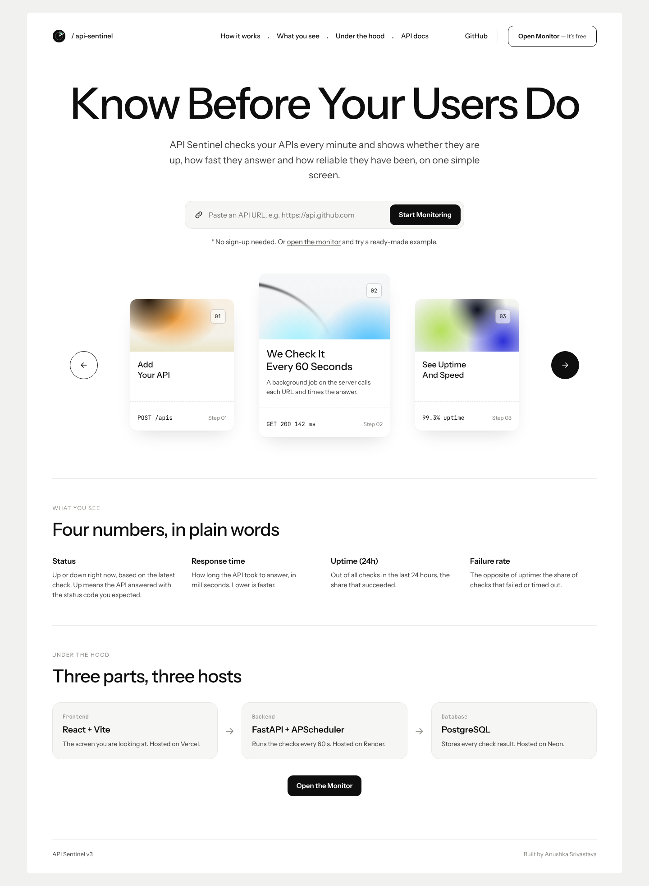
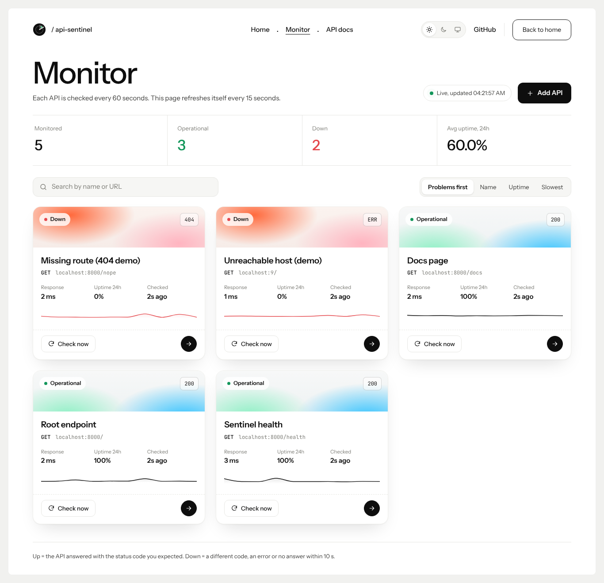
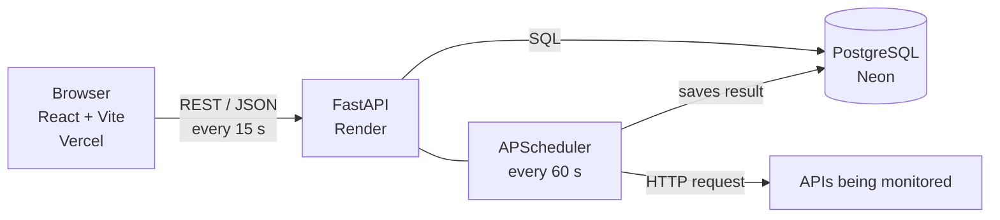

# API Sentinel

**Know before your users do.** API Sentinel watches your APIs every minute and shows whether they
are up, how fast they answer, and how reliable they have been over the last 24 hours.


**Live demo:** https://frontend-swart-gamma-77.vercel.app &nbsp;|&nbsp; **API docs:** https://api-sentinel-v3-backend.onrender.com/docs



---

## What it does

1. **You add an API**: paste a URL, choose the status code that means "healthy" (usually 200).
2. **The server checks it every 60 seconds**: a background job calls the URL, times the answer and saves the result.
3. **You see the result**: status, response time, 24-hour uptime and failure rate, a trend line per API, and a detailed chart.



| Metric | Meaning |
|---|---|
| **Status** | Up when the latest check returned the expected status code; Down otherwise (wrong code, error, or no answer in 10 s) |
| **Response time** | Milliseconds between sending the request and getting the answer |
| **Uptime (24h)** | Successful checks / all checks in the last 24 hours |
| **Failure rate (24h)** | 100% minus uptime |

---

## Architecture



- **Frontend (Vercel):** two pages. `/` explains the product; `/monitor` is the live dashboard. It polls the backend every 15 s.
- **Backend (Render):** FastAPI exposes a REST API. Inside the same process, APScheduler runs a "sweep" every 60 s that checks every active API.
- **Database (Neon):** two tables. `endpoints` holds what to watch; `health_checks` is an append-only log of every check. Uptime and failure rate are **calculated from that log** when you ask, never stored.

### REST API

| Method | Path | What it does |
|---|---|---|
| GET | `/health` | Is the server (and database) up? |
| GET | `/apis` | All monitored APIs with live status |
| POST | `/apis` | Add an API (and check it immediately) |
| GET | `/apis/summary` | Totals for the dashboard |
| GET / PATCH / DELETE | `/apis/{id}` | Read, update (rename, pause) or remove one API |
| GET | `/apis/{id}/history` | Past checks, for the chart |
| POST | `/apis/{id}/check-now` | Check right now instead of waiting |

Interactive docs: open `/docs` on the backend.

---

## Run it locally (VS Code, Windows)

You need **Python 3.11+** and **Node.js 18+**. No database setup: locally it uses a SQLite file.

**Terminal 1: backend**
```
cd backend
python -m venv venv
venv\Scripts\activate
pip install -r requirements.txt
uvicorn app.main:app --reload
```
Open http://localhost:8000/docs

**Terminal 2: frontend**
```
cd frontend
npm install
npm run dev
```
Open http://localhost:5173

> macOS / Linux: use `source venv/bin/activate` instead of `venv\Scripts\activate`.

**Or with Docker (Postgres included):** `docker compose up --build`

---

## Deploy

Full beginner-friendly guide: **[DEPLOY.md](DEPLOY.md)**. In short:

1. **Neon:** create a free project and copy the connection string.
2. **Render:** New, then Blueprint, then this repo. Paste the Neon string as `DATABASE_URL`.
3. **Vercel:** import the repo, set Root Directory `frontend` and `VITE_API_BASE` = your Render URL.
4. **Render:** set `CORS_ORIGINS` to your Vercel URL.

### Environment variables

| Variable | Where | Example | Purpose |
|---|---|---|---|
| `DATABASE_URL` | Render | `postgresql://...neon.tech/neondb?sslmode=require` | Which database to use (SQLite if not set) |
| `CORS_ORIGINS` | Render | `https://api-sentinel-v3.vercel.app` | Which website may call the API |
| `SWEEP_INTERVAL_SECONDS` | Render | `60` | How often checks run |
| `REQUEST_TIMEOUT_SECONDS` | Render | `10` | Max wait for a monitored API |
| `PYTHON_VERSION` | Render | `3.11.9` | Python version used for the build |
| `VITE_API_BASE` | Vercel | `https://api-sentinel-v3-backend.onrender.com` | Where the frontend finds the backend |

---

## What changed in v3

| Area | v2 | v3 |
|---|---|---|
| Database | Render free Postgres (**expired after 30 days**, backend crashed) | **Neon** free Postgres (does not expire) |
| Startup | Created tables at import time, so if the DB was down the server crashed (`Exited with status 1`) | Connects in a background thread with retries; API stays up and answers `503` until the DB is back |
| Neon readiness | n/a | `pool_pre_ping` + `pool_recycle` handle Neon closing idle connections |
| UI | Dark single dashboard | Light, minimal **Home** page + **Monitor** page, one click between them |
| Sleeping server | "Can't reach backend" error | Friendly "Waking up the server" banner with automatic retries |
| First-time users | Empty screen | One-click example APIs, plain-language metric explanations |
| Status detail | Up/down only | Shows the HTTP code of the latest check (200, 404, ERR) |

The core is unchanged: same two tables, same 60-second scheduler, same REST API, same uptime maths.

---

## How I would explain it

> API Sentinel is a full-stack API monitoring platform. A FastAPI backend runs an APScheduler job every
> 60 seconds that calls each registered endpoint, measures latency, compares the status code with the
> expected one and appends the result to PostgreSQL. Uptime and failure rate are derived from that log
> over a rolling 24-hour window. A React dashboard polls the API and shows status, trends and history.
> The frontend is on Vercel, the backend on Render, and the database on Neon.

## Known limitations and next steps

- Checks run one after another; a thread pool or async `httpx` would check many APIs in parallel.
- The scheduler lives inside the API process; at scale it would move to a separate worker.
- No user accounts yet (JWT auth and per-user data are the next step).
- No alerts yet (email or Slack when an API goes down).
- Free hosting sleeps when idle, so checks pause while nobody is using the site.

---

Built by **Anushka Srivastava** · [GitHub](https://github.com/anu091104) · [LinkedIn](https://linkedin.com/in/anushka0904)
